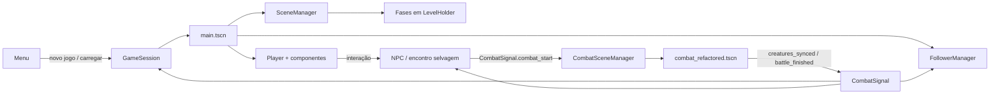
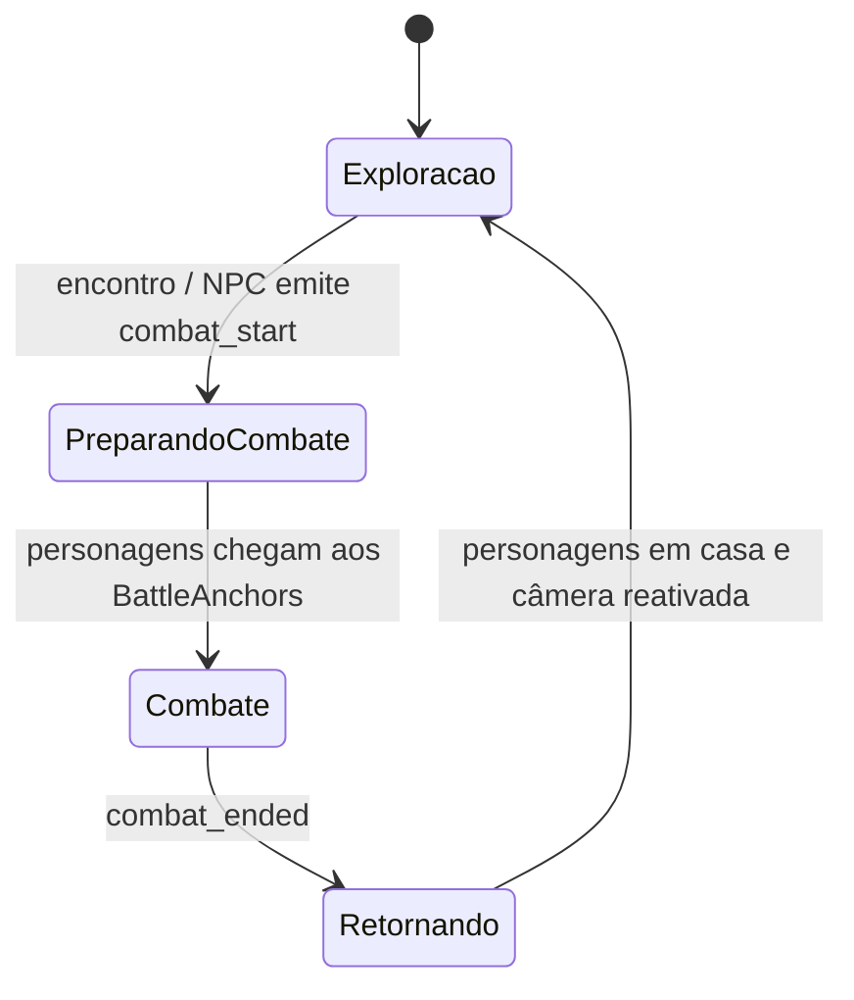
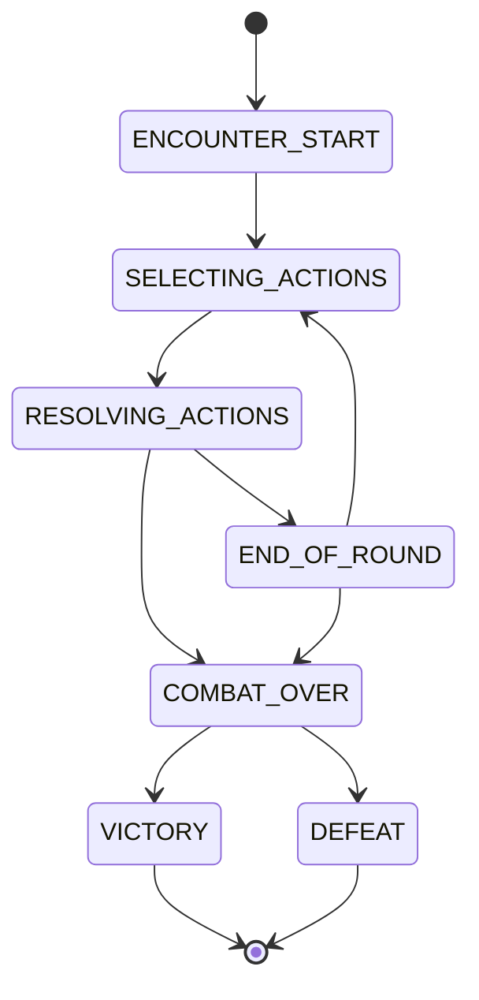
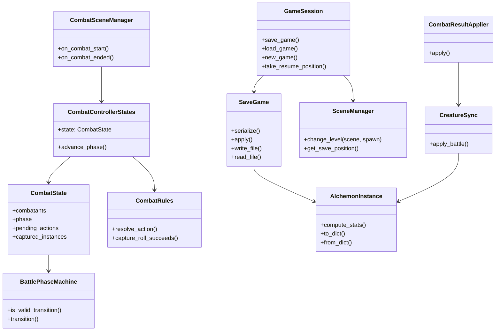

# Arquitetura técnica e testes internos

Este documento descreve a organização interna do **TCC-Jogo**, os fluxos
principais entre cenas e sistemas, a máquina de estados do combate e a
estratégia de testes automatizados.

## 1. Organização interna do código

O projeto é organizado por responsabilidade:

| Diretório | Responsabilidade |
|---|---|
| `scenes/` | Cenas de entrada, carregamento de fases, portas, NPCs e gerenciamento do nível atual. |
| `EXPLORATION/` | Jogador, movimentação, câmera, seguidores, NPCs e encontros no mapa. |
| `COMBAT/` | Estado da batalha, regras, fases, ações, campo de batalha, recompensas e sincronização das criaturas. |
| `DATABASE/` | Modelos e recursos persistentes do jogador, criaturas, inventário e salvamento. |
| `INTERFACES/` | Menus, HUD, comandos de batalha, inventário e telas de resultado. |
| `autoload/` | Serviços globais de sessão e sinais de comunicação entre sistemas. |
| `test/` | Suítes automatizadas executadas pelo GdUnit4. |

### 1.1 Cena principal e cenas de exploração

`scenes/main.tscn` funciona como composição da sessão de exploração. Ela
contém o `Player`, `CameraRig`, `FollowerManager`, `SceneManager`,
`CombatSceneManager`, `LevelHolder`, `BattleAnchors` e os elementos de HUD.
As fases (`scenes/scene_1.tscn`, `scenes/scene_2.tscn`) são carregadas
dinamicamente pelo `SceneManager`, que remove a fase anterior, instancia a
nova e posiciona o jogador no `Marker3D` de destino.

O jogador é uma `CharacterBody3D` composta por componentes:

- `MovementComponent`: lê as ações de entrada e aplica deslocamento e
  gravidade;
- `InteractionComponent`: identifica objetos interagíveis;
- `InventoryComponent`: coleta e manipula itens;
- `CombatHandler`: inicia e encerra a integração com o combate.

Essa composição evita concentrar movimentação, interação e inventário em uma
única classe monolítica.

### 1.2 Gerenciadores globais e comunicação

O projeto utiliza dois autoloads registrados em `project.godot`:

- `GameSession`: mantém o progresso em memória, controla novo jogo,
  carregamento, salvamento, posição no mundo e autosave;
- `CombatSignal`: concentra sinais de ciclo de combate, sincronização de
  criaturas, mudança de grupo e comunicação com NPCs e seguidores.

Os sinais permitem que os participantes reajam sem referências diretas entre
as cenas. Por exemplo, o `CombatSceneManager` cria a cena de combate quando
recebe `combat_start`, enquanto `FollowerManager`, `SceneManager` e o jogador
reagem aos eventos de encerramento ou mudança de grupo.

### 1.3 Camadas do combate

O combate é dividido em camadas com responsabilidades distintas:

1. `CombatSceneManager` integra o combate à cena de exploração: move
   personagens para os marcadores, instancia adversários e restaura a
   posição ao final.
2. `CombatControllerStates` orquestra a batalha e traduz comandos da
   interface em ações.
3. `CombatState` e `CombatantState` representam exclusivamente os dados
   transitórios da batalha.
4. `CombatRules`, `BattlefieldRules`, `BondRules` e `BattleRewards` aplicam
   regras de domínio.
5. `CombatResultApplier` e `CreatureSync` transferem o resultado para os
   recursos persistentes.
6. `INTERFACES/` apresenta opções e resultados, sem decidir regras de
   batalha.

O `CombatStateFactory` cria o estado inicial a partir do grupo do jogador,
dos adversários, dos recursos de dados e do vínculo alquímico ativo. Assim,
os objetos persistentes (`AlchemonInstance`) não são usados como estado
mutável de cada rodada.

## 2. Mecânicas principais implementadas

### 2.1 Exploração, encontros e interação

O jogador é controlado por `EXPLORATION/Player/player.gd` e seus
componentes. `MovementComponent` converte as ações `move_up`,
`move_down`, `move_left` e `move_right` em velocidade, aplica gravidade e
executa `move_and_slide()`. `InteractionComponent` identifica o objeto na
área de interação; quando o jogador pressiona `ui_interact`, o
`InventoryComponent` coleta o item correspondente.

Os encontros selvagens são implementados por `WildernessEncounter`. Enquanto
o jogador está dentro da área, o jogo pode rolar um encontro em intervalos
configuráveis. A mecânica possui duas decisões independentes: primeiro a
chance de iniciar uma luta; depois a escolha aleatória de uma espécie da
lista da área. Encontros não ocorrem durante outro combate e respeitam um
tempo de recarga após o retorno à exploração.

NPCs lutadores usam `NPC.gd`. Ao entrar na área de combate, o NPC envia
`CombatSignal.combat_start`, informa as espécies adversárias e marca a luta
como batalha de treinador. Depois de uma vitória, `battle_finished` chama
`mark_defeated()`, desativa o NPC e registra seu identificador estável no
`GameSession`, impedindo a repetição após o salvamento.

### 2.2 Sistema de captura e armazenamento

Cada criatura do jogador é um `AlchemonInstance`, identificado por um UID
permanente. O objeto guarda espécie, nome, nível, experiência, valor
individual, personalidade, HP atual, energia e ataques. A equipe ativa fica
em `PlayerPartyData.party`; as criaturas fora da equipe ficam em
`CapturedStorage.instances`, o armazenamento acessado pela interface do PC.
Mover uma criatura entre equipe e armazenamento conserva o mesmo objeto e,
portanto, não perde nível, XP, IV, personalidade ou HP.

O fluxo de captura é:

1. A interface envia um `ActionCommand` do tipo `capture`.
2. `CombatRules._resolve_capture()` valida alvo e item, compara o tipo da
   ferramenta com o tipo da criatura e calcula o valor `a` com
   `AlchemonFormulas.compute_capture_value(max_hp, hp, x)`.
3. Uma rolagem de `0` a `254` é bem-sucedida quando é menor que `a`; o
   valor é limitado entre `1` e `255`. Assim, reduzir o HP aumenta a chance,
   e `a = 255` garante a captura.
4. `CombatResultApplier._apply_capture()` recupera o indivíduo exato
   combatido de `CombatState.enemy_instances`, grava nele o HP da batalha e
   coloca a instância em `captured_instances`. A criatura capturada é
   marcada como derrotada no campo, mas permanece com pelo menos 1 HP no
   armazenamento.
5. O controlador transfere `captured_instances` para
   `CapturedStorage.add_instance()`. O armazenamento é sincronizado pelo
   `GameSession` e persistido no JSON do salvamento.

Trainer battles bloqueiam captura; a captura só é permitida contra
adversários de encontros selvagens. A gravação usa `SaveGame.serialize()` e
`AlchemonInstance.to_dict()`, enquanto o carregamento reconstrói e valida as
instâncias com `from_dict()`, elimina entradas inválidas e corrige UIDs
duplicados.

### 2.3 Sistema de combate e atributos

`CombatSceneManager` cria a cena de combate, posiciona os participantes e
injeta equipe, inventário, banco de espécies, armazenamento e vínculo
alquímico. `CombatControllerStates` conduz a batalha, coleta comandos do
jogador e enfileira comandos da IA. A resolução é separada da mutação:
`CombatRules` calcula um `CombatResult`, e
`CombatResultApplier` é o único componente que altera `CombatState`.

Os comandos implementados são:

- **ataque**: valida o alvo, ataque e espécie; calcula dano considerando
  nível, ataque, defesa e efetividade elemental; aplica chance de erro,
  crítico de 1,5x e custo de energia;
- **item**: aplica cura ao aliado, limitada ao HP máximo;
- **captura**: executa a fórmula descrita acima;
- **fuga**: usa uma chance de sucesso de `5/6`;
- **Slap**: ataque substituto sem custo quando a criatura não possui
  elétrons de valência disponíveis.

A iniciativa é calculada a partir da velocidade mecânica, IV e nível.
Todos os participantes ativos precisam ter um comando antes de a rodada
avançar para `RESOLVING_ACTIONS`; criaturas mortas ou cátions de compostos
não participam da seleção de ações nem podem ser alvos.

Os atributos derivados não são armazenados diretamente. No início do combate,
`CombatStateFactory` chama `AlchemonInstance.compute_stats()`, que calcula:

- **HP máximo** pela fórmula de HP base, IV e nível;
- **ataque**, **defesa**, **velocidade mecânica** e **energia de ação**
  pelas fórmulas base, IV e nível;
- modificadores de personalidade nos atributos correspondentes;
- **temperatura de referência** e estado físico a partir da ficha da espécie.

O combate também mantém uma temperatura global da arena. Golpes que acertam
podem aquecê-la; cada criatura viva compara a nova temperatura com seu ponto
de referência e pode mudar de sólido para líquido ou gasoso, recebendo o
dano definido para a mudança. Vínculos alquímicos são aplicados ao estado
transitório da batalha e seus bônus não são gravados como atributos
permanentes.

### 2.4 Progressão e condições de vitória/derrota

Quando um ataque derrota um inimigo ou uma captura é concluída,
`CombatResultApplier._grant_xp()` concede ao autor a recompensa de XP
definida na ficha da espécie derrotada. `AlchemonGrowth.grant_experience()`
acumula a experiência e, a cada `100` pontos, chama `level_up()`. O excesso
de XP permanece para o próximo nível e vários níveis podem ser obtidos em
uma única recompensa.

No level up, o código recalcula ataque, defesa e velocidade; aumenta o limite
de energia e amplia o HP máximo. Se a criatura estiver viva, o aumento do HP
máximo também é adicionado ao HP atual. O `BattleRewards` compara nível e XP
antes/depois e prepara os dados exibidos na tela de recompensas.

Após cada resultado, `CombatRules.check_combat_end()` verifica os dois
grupos. Se não houver criaturas vivas no grupo do jogador, o estado passa a
`DEFEAT`; se não houver criaturas vivas no grupo inimigo, passa a `VICTORY`.
O estado é marcado como encerrado, os slots ocupados são liberados e o
controlador apresenta as recompensas antes de emitir `combat_ended`.

Em vitória contra treinador, `BattleRewards.money_for()` concede atualmente
100 moedas; vitórias contra encontros selvagens não concedem moedas. O NPC
derrotado é marcado como concluído e a exploração é restaurada. A derrota
também encerra a batalha e retorna à exploração conforme o fluxo do
`CombatSceneManager`, mas não concede moedas.

Ao final, `CreatureSync.apply_battle()` grava de volta apenas nível, XP, HP e
energia configurada. O pareamento é feito pelo UID da criatura, nunca pela
posição na lista. O comportamento atual revive criaturas com 0 HP no início
do próximo combate e recarrega a energia a cada batalha, conforme as
constantes de `CreatureSync`; esses pontos estão explicitamente isolados para
futura alteração quando houver uma estação de cura.

### 2.5 Salvamento e continuidade da progressão

`GameSession` mantém as referências compartilhadas à equipe, armazenamento,
inventário, dados do jogador e vínculos. `save_game()` serializa tudo para
`user://saves/slot_1.json`, incluindo criaturas, moedas, NPCs derrotados,
inventário e posição do jogador. `SaveGame.write_file()` grava de forma
atômica e mantém um arquivo `.bak`; em caso de corrupção, `read_file()`
tenta recuperar o backup.

`load_game()` restaura os dados e entrega a posição salva ao
`SceneManager`, que reabre a fase correta e reposiciona o jogador. Dessa
forma, captura, evolução, moedas, NPCs derrotados e localização do jogador
fazem parte do mesmo estado persistente.

## 3. Máquina de estados do jogador e do combate

### 3.1 Estado do jogador durante a exploração

O jogador não possui uma enumeração explícita de estados; sua composição
define dois fluxos operacionais:

- **Exploração**: `Player` executa `MovementComponent` a cada frame e aceita
  interação pelo `InteractionComponent`;
- **Combate**: `CombatHandler` reage ao sinal de início, enquanto o
  `CombatSceneManager` desativa temporariamente a câmera e desloca os
  personagens para as posições de batalha. Depois do resultado, os
  personagens retornam aos pontos originais e a exploração é liberada.

### 3.2 Máquina de estados da batalha

`BattlePhaseMachine` define as transições válidas. A classe
`BattlePhaseRules` expõe os mesmos contratos para o controlador e para as
regras, evitando tabelas de transição duplicadas.

Durante `SELECTING_ACTIONS`, os comandos do jogador são coletados e as
ações da inteligência artificial são enfileiradas. Em
`RESOLVING_ACTIONS`, `CombatRules` resolve a ordem e os efeitos. A rodada
volta para `END_OF_ROUND` ou termina em `COMBAT_OVER`; a tela de recompensas
é exibida antes da liberação definitiva do jogador.

## 4. Diagrama de classes e dependências

O diagrama abaixo apresenta as relações centrais, sem representar todos os
recursos artísticos e nós puramente visuais.

## 5. Desacoplamento e independência de engine

O desacoplamento foi aplicado separando **dados e regras** da
**orquestração de cenas**:

- regras como fórmulas, transições, cálculo de captura, recompensas e
  sincronização são implementadas em classes `RefCounted`, `Resource` ou
  funções sem dependência de uma cena específica;
- `CombatState` representa o estado transitório sem assumir a árvore de
  nós;
- `SaveGame` concentra serialização e leitura, permitindo testes sem
  inicializar uma fase;
- componentes de Godot (`Node`, `CharacterBody3D`, `CanvasLayer` e cenas)
  funcionam como adaptadores de entrada, apresentação e ciclo de vida;
- os recursos persistentes são atualizados apenas nas fronteiras definidas,
  principalmente por `CreatureSync`, `CombatResultApplier` e `GameSession`.

Essa organização não elimina a dependência de Godot — cenas, recursos e
entrada continuam sendo responsabilidades da engine —, mas mantém o núcleo
de regras independente da árvore visual. Como resultado, fórmulas e fluxos
podem ser exercitados em testes sem reproduzir uma partida completa.

## 6. Testes internos

O projeto usa o plugin **GdUnit4**, habilitado em `project.godot`. As suítes
atuais em `test/` cobrem:

| Suíte | Escopo |
|---|---|
| `test_alchemonGrowth.gd` | Fórmulas de atributos, evolução, energia e estado físico. |
| `test_capture_formula.gd` | Valor de captura, limites, redução de oito bits, rolagem, ferramenta correta/incorreta e resolução probabilística. |
| `test_creature_persistence.gd` | UID, serialização JSON, saneamento de dados, atributos derivados, HP, sincronização de batalha e captura do indivíduo correto. |
| `test_battle_rewards.gd` | Moedas, experiência, level up, textos da tela de recompensa, entrada de teclado/controle e ordem de encerramento do combate. |

Os testes validam tanto unidades de domínio quanto fronteiras importantes do
fluxo de jogo. Entre os contratos protegidos estão:

- uma criatura capturada preserva o indivíduo que foi combatido;
- resultados são sincronizados por UID, não pela posição no grupo;
- dados inválidos de salvamento são normalizados ou rejeitados;
- bônus temporários de vínculo não vazam para a criatura persistente;
- a tela de recompensas aparece antes de `combat_ended` liberar a exploração;
- valores de captura permanecem entre 1 e 255.

### Execução

Com o Godot 4 disponível no ambiente, a execução pode ser feita pelo
runner do GdUnit4 no editor ou pela ferramenta de linha de comando do
plugin, apontando para o projeto `tcc-jogo/`. O arquivo
`addons/gdUnit4/GdUnitRunner.cfg` mantém o inventário dos testes descobertos
e seus caminhos `res://test/*.gd`.

## 7. Matriz de QA por requisito

Os códigos abaixo organizam os requisitos funcionais para verificar
pontualmente se cada recurso planejado está implementado. A matriz combina
testes automatizados existentes com cenários manuais de integração. O status
**Aprovado** indica que há caso automatizado cobrindo o comportamento;
**Aprovado com Ressalva** indica que a regra possui cobertura automatizada,
mas a integração visual ou a execução em uma partida ainda deve ser
confirmada no Godot; **Reprovado** deve ser usado quando o resultado esperado
não for atingido.

| Código do requisito | Descrição da mecânica / funcionalidade | Cenário do teste executado | Resultado esperado | Status final |
|---|---|---|---|---|
| RF01 | Movimentação e interação do jogador | Iniciar a exploração, mover em quatro direções e pressionar a tecla de interação diante de um item. | O jogador se desloca com colisão, a interação identifica o objeto e o item é adicionado ao inventário. | Aprovado com Ressalva |
| RF02 | Encontro selvagem | Entrar em uma área de encontro e caminhar até ocorrer uma rolagem; repetir durante o combate e no período de recarga. | A luta ocorre conforme a chance configurada, um adversário válido é escolhido, nenhum novo encontro começa durante a batalha e o cooldown é respeitado. | Aprovado com Ressalva |
| RF03 | Batalha contra treinador | Entrar na área de combate de um NPC configurado como lutador. | O NPC inicia o combate com as espécies e nível definidos; a captura fica bloqueada. | Aprovado com Ressalva |
| RF04 | Seleção e resolução de ações | Em uma rodada, selecionar ataque, item, captura ou fuga e aguardar a resolução de todos os participantes. | Cada participante ativo recebe uma ação, a ordem de iniciativa é respeitada e a fase muda de seleção para resolução sem comandos incompletos. | Aprovado com Ressalva |
| RF05 | Dano, erro, crítico e energia | Resolver ataques com energia suficiente, sem energia, com erro e com crítico. | O dano usa atributos e efetividade elemental; erro não causa dano; crítico aplica multiplicador; a energia é descontada e o ataque alternativo é usado quando necessário. | Aprovado com Ressalva |
| RF06 | Uso de itens de combate | Usar um item de cura em um aliado com HP parcial e repetir quando o HP estiver cheio. | A cura é aplicada somente a aliado válido e nunca ultrapassa o HP máximo; itens de captura não são aceitos como cura. | Aprovado com Ressalva |
| RF07 | Fórmula de captura | Tentar capturar uma criatura com HP cheio, HP baixo, ferramenta compatível e ferramenta incompatível. | A chance aumenta com a redução do HP, permanece entre 1 e 255, a ferramenta compatível é mais eficaz e o valor 255 sempre captura. | Aprovado |
| RF08 | Posse e armazenamento de criaturas | Capturar uma criatura, adicioná-la ao armazenamento do PC, movê-la para a equipe e salvar/recarregar. | A mesma instância, identificada pelo UID, mantém espécie, IV, personalidade, HP, XP e nível em todas as transferências. | Aprovado |
| RF09 | Preservação do indivíduo capturado | Capturar uma criatura com HP reduzido e comparar a criatura armazenada com a instância adversária usada na batalha. | O indivíduo capturado é exatamente o combatido, conserva seus dados individuais e permanece com pelo menos 1 HP. | Aprovado |
| RF10 | Atributos e estados físicos | Criar criaturas em níveis diferentes, alterar personalidade e aquecer a arena durante um golpe. | Atributos derivados são recalculados por fórmula; personalidade altera apenas os atributos previstos; mudanças de temperatura alteram o estado físico e aplicam o efeito configurado. | Aprovado com Ressalva |
| RF11 | Experiência e evolução | Conceder XP abaixo de 100, cruzar o limite e conceder XP suficiente para vários níveis. | XP abaixo do limite fica acumulado; a cada 100 pontos ocorre level up; o excedente é preservado; atributos, energia máxima e HP máximo são atualizados. | Aprovado |
| RF12 | Vitória e derrota | Derrotar todos os inimigos e, em outro cenário, perder todos os membros ativos do grupo. | O combate entra em `VICTORY` ou `DEFEAT`, libera os slots, exibe recompensas e só depois libera a exploração. | Aprovado com Ressalva |
| RF13 | Recompensas e NPC derrotado | Vencer um treinador, vencer um encontro selvagem e perder uma batalha. | Vitória contra treinador concede 100 moedas; batalha selvagem e derrota não concedem moedas; NPC derrotado é marcado e não inicia novo combate. | Aprovado com Ressalva |
| RF14 | Salvamento e continuidade | Salvar equipe, armazenamento, inventário, moedas, NPC derrotado e posição; recarregar e corromper o arquivo principal. | O JSON é restaurado integralmente; a posição e a fase são retomadas; o backup `.bak` recupera um arquivo principal inválido. | Aprovado |

Os casos **RF07**, **RF08**, **RF09**, **RF11** e **RF14** possuem
correspondência direta nas suítes `test_capture_formula.gd`,
`test_creature_persistence.gd`, `test_alchemonGrowth.gd` e
`test_battle_rewards.gd`. Os casos de integração visual permanecem com
ressalva porque dependem da execução das cenas, entrada do jogador, física,
HUD e sinais entre nós.

## 8. Discussão dos casos críticos

Os casos que exigiram maior cuidado foram captura, persistência e o limite
entre estado de batalha e dados permanentes. A captura não podia apenas
registrar a espécie: era necessário preservar o indivíduo exato combatido,
incluindo UID, IV, personalidade e HP restante. Por isso, o fluxo passou a
guardar `enemy_instances` no `CombatState`, aplicar o resultado em
`CombatResultApplier` e só então transferir a instância para
`CapturedStorage`. A fórmula também recebeu testes de limites para HP cheio,
HP mínimo, valor máximo, redução de oito bits e ferramenta incompatível.

Na persistência, uma falha importante ocorria quando os resultados eram
associados à equipe pela posição do vetor. Uma criatura inválida ou removida
no meio da lista fazia o HP e o XP serem gravados na criatura errada. O
problema foi corrigido em `CreatureSync.apply_battle()`, que indexa as
criaturas por UID; o caso `test_results_match_by_uid_not_by_position`
registra essa regressão. Outro problema era o bônus temporário de vínculo
ser copiado para atributos permanentes. A escrita de volta passou a limitar
o HP pelo máximo real da criatura e a ignorar atributos derivados, mantendo
o bônus apenas no estado transitório.

Também houve uma falha de ordem no encerramento do combate: a emissão
prematura de `combat_ended` liberava a exploração antes da tela de
recompensas terminar. A responsabilidade foi concentrada no controlador,
que aplica o resultado, sincroniza as criaturas, apresenta as recompensas e
somente depois emite o sinal final; `test_rules_layer_no_longer_ends_combat_for_exploration`
protege esse comportamento. Na camada de salvamento, dados malformados,
versões futuras, UIDs duplicados e corrupção do arquivo principal passaram a
ser tratados por validação atômica, saneamento, reparo de UID e recuperação
do backup, cobertos pelos casos de persistência.

### Observação sobre a execução

Os status da matriz refletem os testes automatizados presentes no repositório
e a verificação do fluxo no código. A execução final da matriz completa deve
ser realizada com o Godot 4 e o GdUnit4 disponíveis, incluindo os cenários
manuais marcados **Aprovado com Ressalva**. O resultado dessa execução pode
ser anexado ao relatório com data, versão do build e evidências de cada
cenário.
