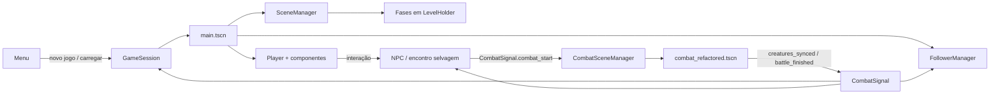
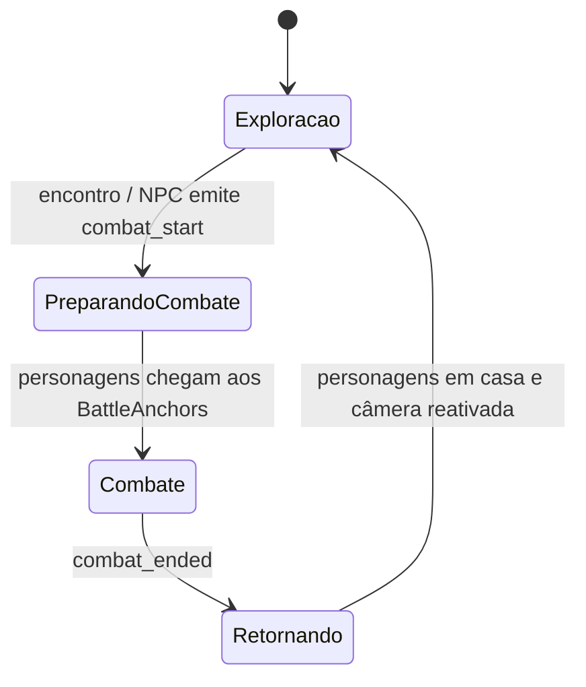
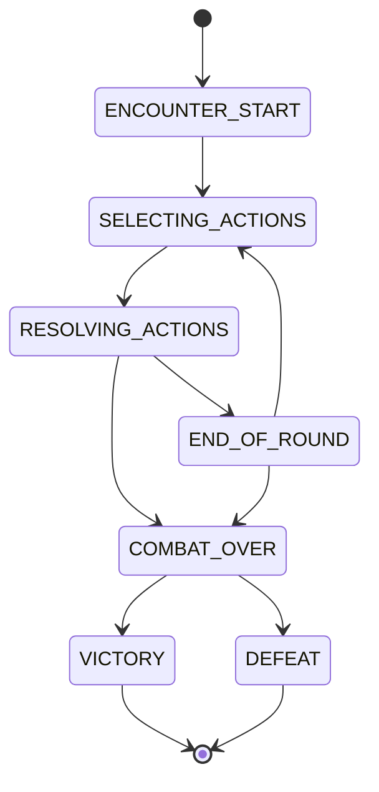
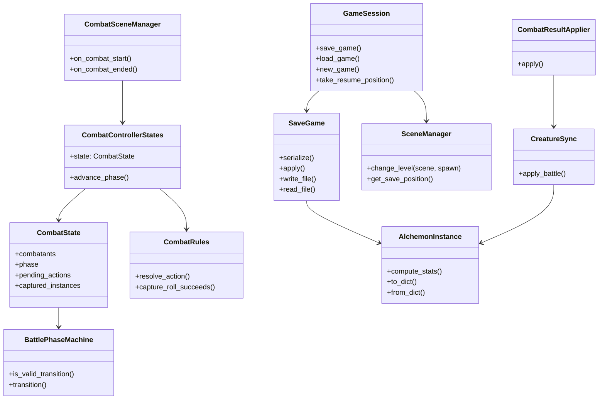

# Arquitetura técnica e testes internos

Este documento descreve a organização interna do **TCC-Jogo**, os fluxos
principais entre cenas e sistemas, a máquina de estados do combate e a
estratégia de testes automatizados.

## 1. Organização interna do código

O projeto é organizado por responsabilidade:

| Diretório | Responsabilidade |
|---|---|
| `scenes/` | Cenas de entrada, carregamento de fases, portas, NPCs e gerenciamento do nível atual. |
| `EXPLORATION/` | Jogador, movimentação, câmera, seguidores, NPCs e encontros no mapa. |
| `COMBAT/` | Estado da batalha, regras, fases, ações, campo de batalha, recompensas e sincronização das criaturas. |
| `DATABASE/` | Modelos e recursos persistentes do jogador, criaturas, inventário e salvamento. |
| `INTERFACES/` | Menus, HUD, comandos de batalha, inventário e telas de resultado. |
| `autoload/` | Serviços globais de sessão e sinais de comunicação entre sistemas. |
| `test/` | Suítes automatizadas executadas pelo GdUnit4. |

### 1.1 Cena principal e cenas de exploração

`scenes/main.tscn` funciona como composição da sessão de exploração. Ela
contém o `Player`, `CameraRig`, `FollowerManager`, `SceneManager`,
`CombatSceneManager`, `LevelHolder`, `BattleAnchors` e os elementos de HUD.
As fases (`scenes/scene_1.tscn`, `scenes/scene_2.tscn`) são carregadas
dinamicamente pelo `SceneManager`, que remove a fase anterior, instancia a
nova e posiciona o jogador no `Marker3D` de destino.

O jogador é uma `CharacterBody3D` composta por componentes:

- `MovementComponent`: lê as ações de entrada e aplica deslocamento e
  gravidade;
- `InteractionComponent`: identifica objetos interagíveis;
- `InventoryComponent`: coleta e manipula itens;
- `CombatHandler`: inicia e encerra a integração com o combate.

Essa composição evita concentrar movimentação, interação e inventário em uma
única classe monolítica.

### 1.2 Gerenciadores globais e comunicação

O projeto utiliza dois autoloads registrados em `project.godot`:

- `GameSession`: mantém o progresso em memória, controla novo jogo,
  carregamento, salvamento, posição no mundo e autosave;
- `CombatSignal`: concentra sinais de ciclo de combate, sincronização de
  criaturas, mudança de grupo e comunicação com NPCs e seguidores.

Os sinais permitem que os participantes reajam sem referências diretas entre
as cenas. Por exemplo, o `CombatSceneManager` cria a cena de combate quando
recebe `combat_start`, enquanto `FollowerManager`, `SceneManager` e o jogador
reagem aos eventos de encerramento ou mudança de grupo.



### 1.3 Camadas do combate

O combate é dividido em camadas com responsabilidades distintas:

1. `CombatSceneManager` integra o combate à cena de exploração: move
   personagens para os marcadores, instancia adversários e restaura a
   posição ao final.
2. `CombatControllerStates` orquestra a batalha e traduz comandos da
   interface em ações.
3. `CombatState` e `CombatantState` representam exclusivamente os dados
   transitórios da batalha.
4. `CombatRules`, `BattlefieldRules`, `BondRules` e `BattleRewards` aplicam
   regras de domínio.
5. `CombatResultApplier` e `CreatureSync` transferem o resultado para os
   recursos persistentes.
6. `INTERFACES/` apresenta opções e resultados, sem decidir regras de
   batalha.

O `CombatStateFactory` cria o estado inicial a partir do grupo do jogador,
dos adversários, dos recursos de dados e do vínculo alquímico ativo. Assim,
os objetos persistentes (`AlchemonInstance`) não são usados como estado
mutável de cada rodada.

## 2. Mecânicas principais implementadas

### 2.1 Exploração, encontros e interação

O jogador é controlado por `EXPLORATION/Player/player.gd` e seus
componentes. `MovementComponent` converte as ações `move_up`,
`move_down`, `move_left` e `move_right` em velocidade, aplica gravidade e
executa `move_and_slide()`. `InteractionComponent` identifica o objeto na
área de interação; quando o jogador pressiona `ui_interact`, o
`InventoryComponent` coleta o item correspondente.

Os encontros selvagens são implementados por `WildernessEncounter`. Enquanto
o jogador está dentro da área, o jogo pode rolar um encontro em intervalos
configuráveis. A mecânica possui duas decisões independentes: primeiro a
chance de iniciar uma luta; depois a escolha aleatória de uma espécie da
lista da área. Encontros não ocorrem durante outro combate e respeitam um
tempo de recarga após o retorno à exploração.

NPCs lutadores usam `NPC.gd`. Ao entrar na área de combate, o NPC envia
`CombatSignal.combat_start`, informa as espécies adversárias e marca a luta
como batalha de treinador. Depois de uma vitória, `battle_finished` chama
`mark_defeated()`, desativa o NPC e registra seu identificador estável no
`GameSession`, impedindo a repetição após o salvamento.

### 2.2 Sistema de captura e armazenamento

Cada criatura do jogador é um `AlchemonInstance`, identificado por um UID
permanente. O objeto guarda espécie, nome, nível, experiência, valor
individual, personalidade, HP atual, energia e ataques. A equipe ativa fica
em `PlayerPartyData.party`; as criaturas fora da equipe ficam em
`CapturedStorage.instances`, o armazenamento acessado pela interface do PC.
Mover uma criatura entre equipe e armazenamento conserva o mesmo objeto e,
portanto, não perde nível, XP, IV, personalidade ou HP.

O fluxo de captura é:

1. A interface envia um `ActionCommand` do tipo `capture`.
2. `CombatRules._resolve_capture()` valida alvo e item, compara o tipo da
   ferramenta com o tipo da criatura e calcula o valor `a` com
   `AlchemonFormulas.compute_capture_value(max_hp, hp, x)`.
3. Uma rolagem de `0` a `254` é bem-sucedida quando é menor que `a`; o
   valor é limitado entre `1` e `255`. Assim, reduzir o HP aumenta a chance,
   e `a = 255` garante a captura.
4. `CombatResultApplier._apply_capture()` recupera o indivíduo exato
   combatido de `CombatState.enemy_instances`, grava nele o HP da batalha e
   coloca a instância em `captured_instances`. A criatura capturada é
   marcada como derrotada no campo, mas permanece com pelo menos 1 HP no
   armazenamento.
5. O controlador transfere `captured_instances` para
   `CapturedStorage.add_instance()`. O armazenamento é sincronizado pelo
   `GameSession` e persistido no JSON do salvamento.

Trainer battles bloqueiam captura; a captura só é permitida contra
adversários de encontros selvagens. A gravação usa `SaveGame.serialize()` e
`AlchemonInstance.to_dict()`, enquanto o carregamento reconstrói e valida as
instâncias com `from_dict()`, elimina entradas inválidas e corrige UIDs
duplicados.

### 2.3 Sistema de combate e atributos

`CombatSceneManager` cria a cena de combate, posiciona os participantes e
injeta equipe, inventário, banco de espécies, armazenamento e vínculo
alquímico. `CombatControllerStates` conduz a batalha, coleta comandos do
jogador e enfileira comandos da IA. A resolução é separada da mutação:
`CombatRules` calcula um `CombatResult`, e
`CombatResultApplier` é o único componente que altera `CombatState`.

Os comandos implementados são:

- **ataque**: valida o alvo, ataque e espécie; calcula dano considerando
  nível, ataque, defesa e efetividade elemental; aplica chance de erro,
  crítico de 1,5x e custo de energia;
- **item**: aplica cura ao aliado, limitada ao HP máximo;
- **captura**: executa a fórmula descrita acima;
- **fuga**: usa uma chance de sucesso de `5/6`;
- **Slap**: ataque substituto sem custo quando a criatura não possui
  elétrons de valência disponíveis.

A iniciativa é calculada a partir da velocidade mecânica, IV e nível.
Todos os participantes ativos precisam ter um comando antes de a rodada
avançar para `RESOLVING_ACTIONS`; criaturas mortas ou cátions de compostos
não participam da seleção de ações nem podem ser alvos.

Os atributos derivados não são armazenados diretamente. No início do combate,
`CombatStateFactory` chama `AlchemonInstance.compute_stats()`, que calcula:

- **HP máximo** pela fórmula de HP base, IV e nível;
- **ataque**, **defesa**, **velocidade mecânica** e **energia de ação**
  pelas fórmulas base, IV e nível;
- modificadores de personalidade nos atributos correspondentes;
- **temperatura de referência** e estado físico a partir da ficha da espécie.

O combate também mantém uma temperatura global da arena. Golpes que acertam
podem aquecê-la; cada criatura viva compara a nova temperatura com seu ponto
de referência e pode mudar de sólido para líquido ou gasoso, recebendo o
dano definido para a mudança. Vínculos alquímicos são aplicados ao estado
transitório da batalha e seus bônus não são gravados como atributos
permanentes.

`AlchemyStation` valida os vínculos pelas regras da Química (`CompoundRules`).
Só existem **2 tipos de composto**; qualquer combinação que não forme um deles
é uma **Mistura**. Nenhum átomo passa de 8 elétrons de valência
(`octet_target ≤ 8`). ΔE é a diferença de eletronegatividade (Pauling) e o
limiar é `CompoundRules.IONIC_THRESHOLD = 2,0`.

- **Iônico:** metal + ametal, ΔE ≥ 2,0 e eletroneutralidade
  `n_cátion · Z_cátion = n_ânion · (8 − V_ânion)`; os metais doam elétrons e o
  ametal recebe até completar o octeto.
- **Covalente:** ametal + ametal, ΔE < 2,0; cada átomo fecha `octeto − valência`
  ligações por pares compartilhados e a molécula precisa ser conectada, com grau
  par e sem átomo que exija mais ligações que os demais juntos (inclui moléculas
  elementares como O₂ e N₂).
- **Mistura:** todo o resto — metal + metal (liga), gás nobre (octeto completo),
  metaloide (não é metal nem ametal), ΔE incompatível com o tipo ou cargas que
  não fecham. Mistura é sempre de 2 Alchemons; 3-4 que não formam composto são
  rejeitados.

Um composto aceita de 2 a `AlchemyStation.MAX_BOND_SIZE` (4) Alchemons; os
membros além dos 2 slots do campo ficam sem slot e o ativo sempre ocupa um slot.

### 2.4 Progressão e condições de vitória/derrota

Quando um ataque derrota um inimigo ou uma captura é concluída,
`CombatResultApplier._grant_xp()` concede ao autor a recompensa de XP
definida na ficha da espécie derrotada. `AlchemonGrowth.grant_experience()`
acumula a experiência e chama `level_up()` sempre que o progresso alcança o
custo do nível atual. A curva é cúbica (Medium Fast): o XP total para atingir
o nível `n` é `n³`, logo subir de `n` para `n+1` custa `(n+1)³ − n³`
(`AlchemonGrowth.xp_to_next()`). O excesso permanece para o próximo nível e
vários níveis podem ser obtidos em uma única recompensa.

Cada `AttackData` possui `unlock_level`, e todos ficam registrados no
`AttackDatabase` global. A lista `attacks` da ficha da espécie define o que ela
pode aprender. Ao criar o combatente, `AttackLearning.sanitize_instance()`
preenche `attack_ids` (máximo de 4) com os ataques já liberados. Em cada
`level_up()`, `AttackLearning.on_level_reached()` aprende automaticamente o
ataque liberado se houver vaga. Com 4 ataques, o do jogador fica pendente e,
ao fim do combate, `AttackLearnScreen` pergunta qual esquecer ou se não
aprende. Inimigos trocam automaticamente o ataque de menor poder.

No level up, o código recalcula ataque, defesa e velocidade; aumenta o limite
de energia e amplia o HP máximo. Se a criatura estiver viva, o aumento do HP
máximo também é adicionado ao HP atual. O `BattleRewards` compara nível e XP
antes/depois e prepara os dados exibidos na tela de recompensas.

Após cada resultado, `CombatRules.check_combat_end()` verifica os dois
grupos. Se não houver criaturas vivas no grupo do jogador, o estado passa a
`DEFEAT`; se não houver criaturas vivas no grupo inimigo, passa a `VICTORY`.
O estado é marcado como encerrado, os slots ocupados são liberados e o
controlador apresenta as recompensas antes de emitir `combat_ended`.

Em vitória contra treinador, `BattleRewards.money_for()` concede atualmente
100 moedas; vitórias contra encontros selvagens não concedem moedas. O NPC
derrotado é marcado como concluído e a exploração é restaurada. A derrota
também encerra a batalha e retorna à exploração conforme o fluxo do
`CombatSceneManager`, mas não concede moedas.

Ao final, `CreatureSync.apply_battle()` grava de volta apenas nível, XP, HP e
energia configurada. O pareamento é feito pelo UID da criatura, nunca pela
posição na lista. O comportamento atual revive criaturas com 0 HP no início
do próximo combate e recarrega a energia a cada batalha, conforme as
constantes de `CreatureSync`; esses pontos estão explicitamente isolados para
futura alteração quando houver uma estação de cura.

### 2.5 Salvamento e continuidade da progressão

`GameSession` mantém as referências compartilhadas à equipe, armazenamento,
inventário, dados do jogador e vínculos. `save_game()` serializa tudo para
`user://saves/slot_1.json`, incluindo criaturas, moedas, NPCs derrotados,
inventário e posição do jogador. `SaveGame.write_file()` grava de forma
atômica e mantém um arquivo `.bak`; em caso de corrupção, `read_file()`
tenta recuperar o backup.

`load_game()` restaura os dados e entrega a posição salva ao
`SceneManager`, que reabre a fase correta e reposiciona o jogador. Dessa
forma, captura, evolução, moedas, NPCs derrotados e localização do jogador
fazem parte do mesmo estado persistente.

## 3. Máquina de estados do jogador e do combate

### 3.1 Estado do jogador durante a exploração

O jogador não possui uma enumeração explícita de estados; sua composição
define dois fluxos operacionais:

- **Exploração**: `Player` executa `MovementComponent` a cada frame e aceita
  interação pelo `InteractionComponent`;
- **Combate**: `CombatHandler` reage ao sinal de início, enquanto o
  `CombatSceneManager` desativa temporariamente a câmera e desloca os
  personagens para as posições de batalha. Depois do resultado, os
  personagens retornam aos pontos originais e a exploração é liberada.



### 3.2 Máquina de estados da batalha

`BattlePhaseMachine` define as transições válidas. A classe
`BattlePhaseRules` expõe os mesmos contratos para o controlador e para as
regras, evitando tabelas de transição duplicadas.



Durante `SELECTING_ACTIONS`, os comandos do jogador são coletados e as
ações da inteligência artificial são enfileiradas. Em
`RESOLVING_ACTIONS`, `CombatRules` resolve a ordem e os efeitos. A rodada
volta para `END_OF_ROUND` ou termina em `COMBAT_OVER`; a tela de recompensas
é exibida antes da liberação definitiva do jogador.

## 4. Diagrama de classes e dependências

O diagrama abaixo apresenta as relações centrais, sem representar todos os
recursos artísticos e nós puramente visuais.



## 5. Desacoplamento e independência de engine

O desacoplamento foi aplicado separando **dados e regras** da
**orquestração de cenas**:

- regras como fórmulas, transições, cálculo de captura, recompensas e
  sincronização são implementadas em classes `RefCounted`, `Resource` ou
  funções sem dependência de uma cena específica;
- `CombatState` representa o estado transitório sem assumir a árvore de
  nós;
- `SaveGame` concentra serialização e leitura, permitindo testes sem
  inicializar uma fase;
- componentes de Godot (`Node`, `CharacterBody3D`, `CanvasLayer` e cenas)
  funcionam como adaptadores de entrada, apresentação e ciclo de vida;
- os recursos persistentes são atualizados apenas nas fronteiras definidas,
  principalmente por `CreatureSync`, `CombatResultApplier` e `GameSession`.

Essa organização não elimina a dependência de Godot — cenas, recursos e
entrada continuam sendo responsabilidades da engine —, mas mantém o núcleo
de regras independente da árvore visual. Como resultado, fórmulas e fluxos
podem ser exercitados em testes sem reproduzir uma partida completa.

## 6. Testes internos

O projeto usa o plugin **GdUnit4**, habilitado em `project.godot`. As suítes
atuais em `test/` cobrem:

| Suíte | Escopo |
|---|---|
| `test_alchemonGrowth.gd` | Fórmulas de atributos, evolução, energia e estado físico. |
| `test_capture_formula.gd` | Valor de captura, limites, redução de oito bits, rolagem, ferramenta correta/incorreta e resolução probabilística. |
| `test_creature_persistence.gd` | UID, serialização JSON, saneamento de dados, atributos derivados, HP, sincronização de batalha e captura do indivíduo correto. |
| `test_battle_rewards.gd` | Moedas, experiência, level up, textos da tela de recompensa, entrada de teclado/controle e ordem de encerramento do combate. |

Os testes validam tanto unidades de domínio quanto fronteiras importantes do
fluxo de jogo. Entre os contratos protegidos estão:

- uma criatura capturada preserva o indivíduo que foi combatido;
- resultados são sincronizados por UID, não pela posição no grupo;
- dados inválidos de salvamento são normalizados ou rejeitados;
- bônus temporários de vínculo não vazam para a criatura persistente;
- a tela de recompensas aparece antes de `combat_ended` liberar a exploração;
- valores de captura permanecem entre 1 e 255.

### Execução

Com o Godot 4 disponível no ambiente, a execução pode ser feita pelo
runner do GdUnit4 no editor ou pela ferramenta de linha de comando do
plugin, apontando para o projeto `tcc-jogo/`. O arquivo
`addons/gdUnit4/GdUnitRunner.cfg` mantém o inventário dos testes descobertos
e seus caminhos `res://test/*.gd`.

## 6.1 Catálogo completo dos testes desenvolvidos

Os testes abaixo são testes automatizados escritos em GDScript com
**GdUnit4**. O tipo indica o nível principal de verificação: **unitário**
testa uma regra ou classe isoladamente; **integração** verifica a colaboração
entre combate, criaturas e recompensas; **persistência** verifica JSON,
arquivos e `GameSession`; **interface** verifica textos e entradas da tela;
**robustez** verifica dados inválidos, limites e recuperação de erro.

### Suíte `test_alchemonGrowth.gd` — 4 testes

| Teste | Tipo | Descrição completa e critério de aprovação |
|---|---|---|
| `test_compute_stat_formula` | Unitário | Verifica a fórmula de atributo para níveis 1, 10 e 50. Aprova se os valores calculados forem 5, 7 e 15 para os parâmetros definidos. |
| `test_level_up_increases_stats` | Unitário | Simula nove evoluções, do nível 1 ao 10. Aprova se nível, ataque, defesa e velocidade mecânica forem recalculados para os valores esperados. |
| `test_level_up_keeps_spent_energy` | Unitário | Parte de uma criatura com energia parcialmente gasta e aplica evoluções. Aprova se somente o aumento do limite for incorporado, sem restaurar a energia ao máximo. |
| `test_state_at` | Unitário de regra | Testa a classificação termodinâmica da criatura em temperatura abaixo do ponto de fusão, entre fusão e ebulição e acima da ebulição. Aprova se retornar sólido, líquido e gasoso. |

### Suíte `test_capture_formula.gd` — 13 testes

| Teste | Tipo | Descrição completa e critério de aprovação |
|---|---|---|
| `test_full_hp_small_creature` | Unitário de fórmula | Calcula a captura de uma criatura pequena com HP cheio. Aprova se o valor for 85. |
| `test_low_hp_raises_value` | Unitário de fórmula | Calcula a captura com HP reduzido a 1. Aprova se o valor subir para 249. |
| `test_value_never_below_one` | Robustez / limite | Usa multiplicador mínimo e verifica o piso da fórmula. Aprova se o resultado nunca for menor que 1. |
| `test_value_capped_at_255` | Robustez / limite | Usa multiplicador excessivo e HP mínimo. Aprova se o valor for limitado a 255. |
| `test_eight_bit_reduction_changes_result` | Unitário de fórmula | Verifica a redução por deslocamentos de bits quando `3 * HP máximo` ultrapassa 255. Aprova se o resultado for 200. |
| `test_reduction_is_two_floor_divisions_by_two` | Unitário de fórmula | Confirma que a redução utiliza duas divisões inteiras sucessivas por dois. Aprova se o resultado for 171. |
| `test_no_reduction_at_exactly_255` | Unitário de limite | Testa o ponto exato 255. Aprova se a redução não ocorrer quando o valor for exatamente 255 e o resultado for 235. |
| `test_bad_input_does_not_crash` | Robustez | Usa HP máximo zero e HP atual acima do máximo. Aprova se a função não quebrar e normalizar o resultado para a faixa válida. |
| `test_roll_rule` | Unitário de regra | Verifica que a rolagem é sucesso quando `roll < a` e falha quando `roll == a`; também confirma que 255 sempre vence. |
| `test_tool_category` | Unitário de regra | Compara ferramenta do mesmo tipo e de tipo diferente. Aprova se os multiplicadores forem 255 e 127, respectivamente. |
| `test_resolver_full_hp_right_tool_is_about_one_third` | Integração probabilística | Executa 600 resoluções reais de captura com HP cheio e ferramenta compatível. Aprova se a quantidade de sucessos ficar entre 150 e 250, aproximadamente um terço. |
| `test_resolver_low_hp_is_almost_certain` | Integração probabilística | Executa 300 resoluções com HP mínimo e ferramenta compatível. Aprova se houver mais de 285 sucessos. |
| `test_resolver_wrong_tool_is_worse_than_right_tool` | Integração probabilística | Compara 600 tentativas com ferramenta compatível e incompatível. Aprova se a ferramenta errada resultar em menos capturas. |

### Suíte `test_battle_rewards.gd` — 11 testes

| Teste | Tipo | Descrição completa e critério de aprovação |
|---|---|---|
| `test_new_player_starts_with_500_coins` | Unitário / configuração | Cria `PlayerData` e carrega o recurso inicial. Aprova se ambos começarem com 500 moedas. |
| `test_add_money_never_goes_negative` | Unitário / limite | Adiciona moedas e depois subtrai um valor maior que o saldo. Aprova se o saldo crescer corretamente e nunca ficar negativo. |
| `test_money_only_for_beating_a_trainer` | Unitário de regra | Avalia vitória e derrota contra treinador e encontro selvagem. Aprova se apenas a vitória contra treinador conceder 100 moedas. |
| `test_xp_gained_without_level_up` | Integração de progressão | Concede 60 XP a uma criatura nível 5. Aprova se a recompensa registrar 60 XP e o nível permanecer 5. |
| `test_xp_gained_across_a_level_up` | Integração de progressão | Parte de 80 XP e concede mais 50. Aprova se a criatura passar ao nível 6 e a recompensa registrar 50 XP ganhos. |
| `test_entry_uses_nickname` | Unitário de apresentação | Define o apelido `Fofo` e constrói a recompensa. Aprova se o nome exibido for o apelido, não o nome da espécie. |
| `test_text_shows_exp_levelup_and_coins` | Interface / apresentação | Monta uma recompensa com XP, level up e moedas. Aprova se a tela gerar as três mensagens correspondentes. |
| `test_text_without_xp_or_money` | Interface / caso vazio | Monta uma recompensa sem XP nem moedas. Aprova se a tela gerar somente `No EXP gained.`. |
| `test_screen_ignores_input_until_delay_then_dismisses_on_any_key` | Interface / entrada | Envia tecla antes do atraso, evento de soltura e depois tecla válida. Aprova se o primeiro input for ignorado, a soltura não fechar a tela e apenas um dismiss ocorrer após o atraso. |
| `test_gamepad_also_dismisses_mouse_does_not` | Interface / entrada | Envia clique do mouse e botão de controle após o atraso. Aprova se o mouse não fechar a tela e o controle fechar uma única vez. |
| `test_rules_layer_no_longer_ends_combat_for_exploration` | Integração de fluxo | Aplica uma captura e observa o sinal global. Aprova se `combat_ended` não for emitido pela camada de regras antes da tela de recompensas. |

### Suíte `test_creature_persistence.gd` — 37 testes

| Teste | Tipo | Descrição completa e critério de aprovação |
|---|---|---|
| `test_uid_is_unique_and_set` | Unitário de identidade | Cria duas criaturas. Aprova se ambas receberem UID não vazio e diferente. |
| `test_ensure_uid_keeps_existing` | Unitário de identidade | Chama `ensure_uid()` em uma criatura já identificada. Aprova se o UID original não mudar. |
| `test_dict_roundtrip_through_real_json` | Persistência / serialização | Serializa uma criatura com apelido, XP, HP, energia, ataques e personalidade, passa por JSON e reconstrói. Aprova se todos os campos forem preservados. |
| `test_from_dict_sanitizes_bad_data` | Robustez / entrada inválida | Carrega nível, XP, IV, HP, personalidade e ataques inválidos. Aprova se os valores forem normalizados e os ataques limitados a quatro. |
| `test_from_dict_without_species_is_rejected` | Robustez / validação | Tenta carregar um dicionário sem espécie. Aprova se a entrada for rejeitada com `null`. |
| `test_stats_are_derived_not_stored` | Unitário de modelo | Inspeciona a criatura persistente. Aprova se defesa e HP máximo não existirem como campos armazenados, evitando vazamento de bônus temporário. |
| `test_neutral_stats_match_formulas` | Unitário de atributos | Compara os atributos neutros calculados pela instância com as fórmulas oficiais. Aprova se ataque e HP máximo coincidirem. |
| `test_personality_changes_only_its_two_stats` | Unitário de atributos | Compara personalidade neutra e `bold`. Aprova se ataque aumentar, defesa diminuir e velocidade e HP máximo permanecerem iguais. |
| `test_hp_unset_means_full_and_zero_means_fainted` | Unitário de estado | Verifica HP não inicializado, HP zero e HP acima do máximo. Aprova se `UNSET` significar cheio, zero significar derrotado e o valor alto for limitado. |
| `test_combatant_is_linked_to_its_creature` | Integração combate/dados | Constrói um `CombatState` a partir da equipe. Aprova se o combatente carregar UID, nível e IV da criatura de origem. |
| `test_battle_hp_is_written_back` | Integração de sincronização | Altera o HP no estado de combate e chama `CreatureSync`. Aprova se o HP persistente receber o valor da batalha. |
| `test_xp_and_level_are_written_back` | Integração de progressão | Concede 250 XP no estado de combate e sincroniza. Aprova se a criatura evoluir do nível 5 para 7 e conservar 50 XP restantes. |
| `test_bond_bonus_does_not_leak_into_creature` | Regressão / integração | Aplica bônus de vínculo, sincroniza e compara com o máximo real. Aprova se o bônus temporário não virar atributo persistente. |
| `test_results_match_by_uid_not_by_position` | Regressão / integração | Insere uma criatura inválida antes de uma criatura válida e sincroniza o HP. Aprova se o resultado for aplicado pelo UID correto, não pela posição da lista. |
| `test_fainted_policy_today_revives_at_battle_start` | Integração de regra | Inicia batalha com criatura cujo HP é zero. Aprova, conforme a política atual, se ela entrar com HP cheio. |
| `test_capture_keeps_the_individual_that_was_fought` | Integração de captura | Captura o inimigo e compara UID, IV, personalidade e HP da instância armazenada com a instância combatida. |
| `test_capture_never_stores_a_fainted_creature` | Integração / limite | Captura um inimigo com 1 HP. Aprova se o objeto armazenado permanecer com pelo menos 1 HP. |
| `test_save_roundtrip_via_disk` | Persistência / integração | Salva equipe, armazenamento, apelido, HP, moedas e vínculo em arquivo e recarrega. Aprova se todos os dados forem reconstruídos. |
| `test_bond_is_saved_by_uid_so_reordering_is_safe` | Persistência / regressão | Reordena a equipe no arquivo salvo. Aprova se o vínculo continuar apontando para as mesmas criaturas por UID. |
| `test_unknown_future_version_is_refused_and_changes_nothing` | Robustez / compatibilidade | Tenta aplicar um formato de salvamento futuro. Aprova se o erro for retornado e os dados atuais não forem alterados. |
| `test_malformed_save_changes_nothing` | Robustez / atomicidade | Tenta aplicar um salvamento com equipe em tipo inválido. Aprova se o erro ocorrer sem modificar a equipe em memória. |
| `test_duplicate_uids_get_repaired_on_load` | Robustez / identidade | Carrega duas criaturas com o mesmo UID. Aprova se a segunda receber uma nova identidade. |
| `test_corrupt_main_file_recovers_from_backup` | Persistência / recuperação | Cria backup, corrompe o arquivo principal e lê novamente. Aprova se o conteúdo válido do `.bak` for recuperado. |
| `test_missing_file_reads_as_empty` | Persistência / ausência | Lê um caminho inexistente. Aprova se o retorno for um dicionário vazio, sem exceção. |
| `test_full_loop_fight_capture_save_reload` | Integração ponta a ponta | Executa construção da batalha, captura, transferência ao armazenamento, sincronização, salvamento e recarga. Aprova se a criatura capturada e o progresso da equipe sobreviverem ao ciclo completo. |
| `test_session_gives_starters_uids_and_saves_and_loads` | Integração `GameSession` | Inicializa a sessão com recursos iniciais, salva uma evolução e recarrega. Aprova se starters receberem UIDs e o nível salvo voltar corretamente. |
| `test_defeated_npcs_roundtrip_via_disk` | Persistência de progresso | Salva NPCs derrotados e recarrega sobre uma lista com dado obsoleto. Aprova se a lista for substituída pelos IDs salvos, sem manter o obsoleto. |
| `test_old_save_without_defeated_key_loads_empty` | Compatibilidade / migração | Remove a chave de NPCs derrotados de um salvamento antigo. Aprova se o carregamento resultar em conjunto vazio. |
| `test_session_new_game_resets_progress` | Integração de ciclo de jogo | Altera dinheiro, equipe e NPC derrotado e chama `new_game()`. Aprova se os starters voltarem, o dinheiro for restaurado e o NPC deixar de estar derrotado. |
| `test_session_defeated_survives_save_load` | Persistência de progresso | Marca NPC, salva, limpa a memória e recarrega. Aprova se o NPC continuar marcado como derrotado. |
| `test_inventory_roundtrip_via_disk` | Persistência de inventário | Salva itens repetidos, recarrega sobre uma mochila diferente e consulta quantidade. Aprova se a lista e a contagem forem restauradas. |
| `test_old_save_without_inventory_keeps_bag` | Compatibilidade / inventário | Carrega salvamento antigo sem inventário. Aprova se a mochila atual for preservada. |
| `test_session_inventory_saved_and_new_game_resets` | Integração de inventário | Adiciona item, salva, limpa, recarrega e inicia novo jogo. Aprova se o item voltar após load e a mochila inicial voltar após reset. |
| `test_no_file_until_player_saves_and_save_replaces` | Persistência / autosave | Altera dados com autosave desligado, confirma ausência de arquivo, salva duas vezes e lê o conteúdo final. Aprova se somente o comando de salvar criar/substituir o arquivo. |
| `test_position_roundtrip_and_resume_once` | Persistência / continuidade | Salva fase, posição e rotação, recarrega e consome a posição de retomada duas vezes. Aprova se a primeira chamada retornar a posição e a segunda retornar vazio. |
| `test_new_game_forgets_position` | Integração de novo jogo | Define uma posição salva e inicia novo jogo. Aprova se a posição for apagada e não houver teleporte de retomada. |
| `test_bad_or_missing_position_loads_as_empty` | Robustez / validação | Aplica posições nulas, incompletas e com tipos inválidos, além de arquivo sem posição. Aprova se todas forem convertidas em posição vazia. |

**Total:** 65 testes automatizados: 4 de crescimento/atributos, 13 de
captura, 11 de recompensas/interface e 37 de persistência, integração e
continuidade da sessão.

## 7. Testes funcionais manuais

Os códigos abaixo organizam os requisitos funcionais para verificar
pontualmente se cada recurso planejado está implementado. A matriz combina
testes automatizados existentes com cenários manuais de integração. O status
**Aprovado** indica que há caso automatizado cobrindo o comportamento;
**Aprovado com Ressalva** indica que a regra possui cobertura automatizada,
mas a integração visual ou a execução em uma partida ainda deve ser
confirmada no Godot; **Reprovado** deve ser usado quando o resultado esperado
não for atingido.

| Código do requisito | Descrição da mecânica / funcionalidade | Cenário do teste executado | Resultado esperado | Status final |
|---|---|---|---|---|
| RF01 | Movimentação e interação do jogador | Iniciar a exploração, mover em quatro direções e pressionar a tecla de interação diante de um item. | O jogador se desloca com colisão, a interação identifica o objeto e o item é adicionado ao inventário. | Aprovado com Ressalva |
| RF02 | Encontro selvagem | Entrar em uma área de encontro e caminhar até ocorrer uma rolagem; repetir durante o combate e no período de recarga. | A luta ocorre conforme a chance configurada, um adversário válido é escolhido, nenhum novo encontro começa durante a batalha e o cooldown é respeitado. | Aprovado com Ressalva |
| RF03 | Batalha contra treinador | Entrar na área de combate de um NPC configurado como lutador. | O NPC inicia o combate com as espécies e nível definidos; a captura fica bloqueada. | Aprovado com Ressalva |
| RF04 | Seleção e resolução de ações | Em uma rodada, selecionar ataque, item, captura ou fuga e aguardar a resolução de todos os participantes. | Cada participante ativo recebe uma ação, a ordem de iniciativa é respeitada e a fase muda de seleção para resolução sem comandos incompletos. | Aprovado com Ressalva |
| RF05 | Dano, erro, crítico e energia | Resolver ataques com energia suficiente, sem energia, com erro e com crítico. | O dano usa atributos e efetividade elemental; erro não causa dano; crítico aplica multiplicador; a energia é descontada e o ataque alternativo é usado quando necessário. | Aprovado com Ressalva |
| RF06 | Uso de itens de combate | Usar um item de cura em um aliado com HP parcial e repetir quando o HP estiver cheio. | A cura é aplicada somente a aliado válido e nunca ultrapassa o HP máximo; itens de captura não são aceitos como cura. | Aprovado com Ressalva |
| RF07 | Fórmula de captura | Tentar capturar uma criatura com HP cheio, HP baixo, ferramenta compatível e ferramenta incompatível. | A chance aumenta com a redução do HP, permanece entre 1 e 255, a ferramenta compatível é mais eficaz e o valor 255 sempre captura. | Aprovado |
| RF08 | Posse e armazenamento de criaturas | Capturar uma criatura, adicioná-la ao armazenamento do PC, movê-la para a equipe e salvar/recarregar. | A mesma instância, identificada pelo UID, mantém espécie, IV, personalidade, HP, XP e nível em todas as transferências. | Aprovado |
| RF09 | Preservação do indivíduo capturado | Capturar uma criatura com HP reduzido e comparar a criatura armazenada com a instância adversária usada na batalha. | O indivíduo capturado é exatamente o combatido, conserva seus dados individuais e permanece com pelo menos 1 HP. | Aprovado |
| RF10 | Atributos e estados físicos | Criar criaturas em níveis diferentes, alterar personalidade e aquecer a arena durante um golpe. | Atributos derivados são recalculados por fórmula; personalidade altera apenas os atributos previstos; mudanças de temperatura alteram o estado físico e aplicam o efeito configurado. | Aprovado com Ressalva |
| RF11 | Experiência e evolução | Conceder XP abaixo de 100, cruzar o limite e conceder XP suficiente para vários níveis. | XP abaixo do limite fica acumulado; a cada 100 pontos ocorre level up; o excedente é preservado; atributos, energia máxima e HP máximo são atualizados. | Aprovado |
| RF12 | Vitória e derrota | Derrotar todos os inimigos e, em outro cenário, perder todos os membros ativos do grupo. | O combate entra em `VICTORY` ou `DEFEAT`, libera os slots, exibe recompensas e só depois libera a exploração. | Aprovado com Ressalva |
| RF13 | Recompensas e NPC derrotado | Vencer um treinador, vencer um encontro selvagem e perder uma batalha. | Vitória contra treinador concede 100 moedas; batalha selvagem e derrota não concedem moedas; NPC derrotado é marcado e não inicia novo combate. | Aprovado com Ressalva |
| RF14 | Salvamento e continuidade | Salvar equipe, armazenamento, inventário, moedas, NPC derrotado e posição; recarregar e corromper o arquivo principal. | O JSON é restaurado integralmente; a posição e a fase são retomadas; o backup `.bak` recupera um arquivo principal inválido. | Aprovado |

Os casos **RF07**, **RF08**, **RF09**, **RF11** e **RF14** possuem
correspondência direta nas suítes `test_capture_formula.gd`,
`test_creature_persistence.gd`, `test_alchemonGrowth.gd` e
`test_battle_rewards.gd`. Os casos de integração visual permanecem com
ressalva porque dependem da execução das cenas, entrada do jogador, física,
HUD e sinais entre nós.

## 8. Discussão dos casos críticos

Os casos que exigiram maior cuidado foram captura, persistência e o limite
entre estado de batalha e dados permanentes. A captura não podia apenas
registrar a espécie: era necessário preservar o indivíduo exato combatido,
incluindo UID, IV, personalidade e HP restante. Por isso, o fluxo passou a
guardar `enemy_instances` no `CombatState`, aplicar o resultado em
`CombatResultApplier` e só então transferir a instância para
`CapturedStorage`. A fórmula também recebeu testes de limites para HP cheio,
HP mínimo, valor máximo, redução de oito bits e ferramenta incompatível.

Na persistência, uma falha importante ocorria quando os resultados eram
associados à equipe pela posição do vetor. Uma criatura inválida ou removida
no meio da lista fazia o HP e o XP serem gravados na criatura errada. O
problema foi corrigido em `CreatureSync.apply_battle()`, que indexa as
criaturas por UID; o caso `test_results_match_by_uid_not_by_position`
registra essa regressão. Outro problema era o bônus temporário de vínculo
ser copiado para atributos permanentes. A escrita de volta passou a limitar
o HP pelo máximo real da criatura e a ignorar atributos derivados, mantendo
o bônus apenas no estado transitório.

Também houve uma falha de ordem no encerramento do combate: a emissão
prematura de `combat_ended` liberava a exploração antes da tela de
recompensas terminar. A responsabilidade foi concentrada no controlador,
que aplica o resultado, sincroniza as criaturas, apresenta as recompensas e
somente depois emite o sinal final; `test_rules_layer_no_longer_ends_combat_for_exploration`
protege esse comportamento. Na camada de salvamento, dados malformados,
versões futuras, UIDs duplicados e corrupção do arquivo principal passaram a
ser tratados por validação atômica, saneamento, reparo de UID e recuperação
do backup, cobertos pelos casos de persistência.

### Observação sobre a execução

Os status da matriz refletem os testes automatizados presentes no repositório
e a verificação do fluxo no código. A execução final da matriz completa deve
ser realizada com o Godot 4 e o GdUnit4 disponíveis, incluindo os cenários
manuais marcados **Aprovado com Ressalva**. O resultado dessa execução pode
ser anexado ao relatório com data, versão do build e evidências de cada
cenário.

## 9. Testes de performance e validação do build

### 9.1 Ambiente e método de medição

O preset de exportação configurado no projeto é **Windows Desktop**, com
arquitetura `x86_64`, renderer `gl_compatibility` e PCK externo. As medições
devem ser feitas no mesmo computador-alvo ou em uma máquina com configuração
registrada, usando uma build release, resolução fixa e a mesma qualidade
gráfica.

Para cada cenário, executar o jogo por pelo menos 60 segundos após a
estabilização inicial, registrar uma amostra por segundo e calcular:

- **FPS médio:** média das amostras de FPS;
- **FPS mínimo:** menor valor observado ou percentil 1%, se a ferramenta
  disponibilizar percentis;
- **tempo de carregamento:** diferença entre o comando de mudança e o
  primeiro frame interativo da nova cena;
- **RAM:** memória residente do processo, medida no início, após exploração
  e durante combate;
- **VRAM:** memória dedicada utilizada pela GPU, medida pelo monitor do
  sistema operacional ou pelo profiler da GPU.

Critérios sugeridos para aprovação do protótipo: FPS médio de pelo menos 60
em exploração e combate, nenhum período sustentado abaixo de 30 FPS, troca
de cena em até 3 segundos, crescimento de RAM estabilizado após o
carregamento inicial e ausência de crescimento contínuo de RAM/VRAM durante
um ciclo repetido de exploração-combate-retorno.

### 9.2 Matriz de testes de performance

| Código | Teste | Procedimento | Métrica / critério de aprovação | Resultado obtido |
|---|---|---|---|---|
| PERF01 | FPS na exploração | Iniciar `main.tscn`, percorrer as duas fases por 60 s e registrar FPS uma vez por segundo. | Média >= 60 FPS; mínimo sustentado >= 30 FPS; sem travamentos visíveis. | **Não executado**: Godot/runtime gráfico não disponível neste ambiente. |
| PERF02 | FPS durante combate | Iniciar encontro selvagem, manter HUD, atores e efeitos ativos por 60 s e registrar FPS. | Média >= 60 FPS; nenhuma queda sustentada abaixo de 30 FPS durante seleção e resolução de ações. | **Não executado**: Godot/runtime gráfico não disponível neste ambiente. |
| PERF03 | Tempo de carregamento de cena | Medir menu -> exploração, `scene_1` -> `scene_2` e retorno após combate, repetindo cada transição cinco vezes. | Média <= 3 s e nenhuma transição acima de 5 s. | **Não executado**: não foi possível iniciar o jogo neste ambiente. |
| PERF04 | Estabilidade da RAM | Registrar RAM no menu, após exploração, durante combate e após cinco ciclos de combate. | Aumento inicial permitido; depois, memória deve estabilizar, sem crescimento monotônico a cada ciclo. | **Não executado**: processo do jogo não pôde ser executado. |
| PERF05 | Estabilidade da VRAM | Repetir PERF04 com monitor de GPU aberto. | Sem crescimento contínuo de VRAM e sem falha de alocação após cinco ciclos. | **Não executado**: GPU/runtime do Windows não disponível neste ambiente. |
| BUILD01 | Integridade dos artefatos Windows | Conferir preset, executável, PCK e arquitetura com `file`; comparar se os arquivos estão presentes. | Preset Windows Desktop x86_64 configurado e `.exe`/`.pck` presentes. | **Aprovado**: preset configurado e artefatos identificados como PE32+ x86-64. |
| BUILD02 | Execução nativa do build | Executar `tcc-jogo.exe` no Windows, iniciar nova partida, carregar uma fase, iniciar combate e fechar sem erro. | Jogo inicia e conclui o fluxo principal sem crash, erro fatal ou recurso ausente. | **Aprovado com Ressalva**: o executável existe, mas sua execução nativa não foi confirmada neste Linux. |
| BUILD03 | Execução do build de combate | Executar `tcc-combat01.exe` no Windows e repetir o fluxo de combate. | Cena de combate abre, aceita comandos, mostra resultado e retorna à exploração sem erro. | **Aprovado com Ressalva**: artefato existe, mas não houve runtime Windows disponível para execução. |

### 9.3 Resultados quantitativos verificáveis no repositório

Foi possível verificar os seguintes artefatos versionados:

| Artefato | Formato identificado | Tamanho |
|---|---|---:|
| `tcc-jogo.exe` | PE32+ Windows x86-64 | 100.598.272 bytes |
| `tcc-jogo.pck` | PCK Godot | 1.341.420 bytes |
| `tcc-combat01.exe` | PE32+ Windows x86-64 | 100.598.272 bytes |
| `tcc-combat01.pck` | PCK Godot | 1.058.800 bytes |

Esses dados comprovam a existência de dois conjuntos de artefatos Windows e
seus respectivos pacotes de recursos. Eles **não** comprovam, isoladamente,
FPS, tempo de carregamento, uso de RAM/VRAM ou execução sem erros. Para que a
validação final seja declarada como totalmente aprovada, é necessário
executar `PERF01` a `PERF05` e `BUILD02`/`BUILD03` em Windows, anexando os
logs ou capturas do profiler, a configuração da máquina, a versão do build
e a data da medição.

### 9.4 Execução automatizada (`tcc-jogo/perf/`)

A bateria é executada por script e gera a tabela sozinha, sem preencher nada à
mão:

```bash
# Linux/macOS (editor/Godot no PATH ou variável GODOT)
GODOT=/caminho/godot RUNS=5 STAGE_SECONDS=60 CYCLES=5 ./tcc-jogo/perf/run_perf.sh
# Windows (PowerShell)
$env:GODOT="C:\Godot\Godot_v4.6-stable_win64_console.exe"; .\tcc-jogo\perf\run_perf.ps1
```

O script faz `RUNS` execuções do modo `load` (um processo novo por execução:
inicialização, carregamento da exploração, carregamento do combate, troca de
fase e retorno do combate) e uma execução do modo `sustained` (FPS por
segundo, 1% inferior, RAM/VRAM/objetos/nós órfãos e `CYCLES` ciclos
exploração → combate → retorno). Em seguida `perf_report_cli.gd` lê os JSON e
os logs e grava, em `tcc-jogo/perf_results/<data>/`, `relatorio.md` (tabelas
prontas, ambiente e veredito por métrica) e `resultados.csv`.

Mapeamento: `PERF01`/`PERF02` = seção 4 do relatório; `PERF03` = seção 3;
`PERF04`/`PERF05` = seção 5; estabilidade = seção 6.

Os critérios ficam em `tcc-jogo/perf/criteria.json` e são copiados para o
relatório. Por padrão o carregamento é apenas registrado (`load_max_ms: null`):
defina um limite só depois de observar os valores no computador-alvo e
justifique no relatório. Use uma build release exportada para a medição final;
a execução pelo editor mede também o overhead do modo debug. A execução com
`HEADLESS=1` mede carregamento e RAM, mas FPS e VRAM aparecem como N/D.

A lógica de estatística e de geração da tabela é coberta por
`test_perf_stats.gd` e `test_perf_report.gd`.

### 9.5 Modelo de registro para a execução no Windows

```text
Build:
Commit:
Data:
Sistema operacional:
CPU:
GPU:
RAM:
Resolução:
Renderer:

PERF01 - exploração: FPS médio / mínimo / RAM inicial-final
PERF02 - combate: FPS médio / mínimo / RAM inicial-final
PERF03 - cenas: menu->jogo / cena1->cena2 / retorno do combate
PERF04 - RAM: início / exploração / combate / após 5 ciclos
PERF05 - VRAM: início / exploração / combate / após 5 ciclos
BUILD02 - tcc-jogo.exe: passou / falhou + log
BUILD03 - tcc-combat01.exe: passou / falhou + log
```
